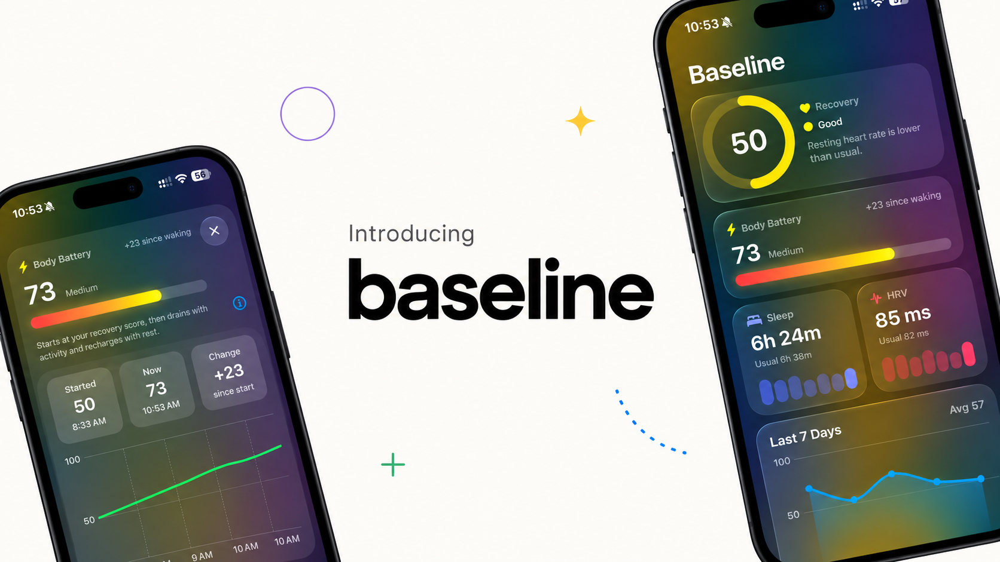

  

# Baseline

**Daily recovery and energy scores from your Apple Health data, compared with your own baseline.**

Baseline is an iOS app that reads heart rate variability (HRV), resting heart rate, sleep, respiratory rate, and wrist temperature from Apple Health. It turns them into two numbers:

- **Recovery (0–100):** how recovered you are this morning compared with your usual
- **Body Charge (0–100):** your energy through the day. It starts at your recovery score, drains with activity and stress, and recharges with rest and sleep.

Every formula and weight is shown in the app. Nothing is a black box.

> [!IMPORTANT]
> **Baseline is not a medical device.** Its scores are experimental, unvalidated estimates meant for personal insight only. They are not medical advice and must not be used to diagnose, treat, or prevent any condition. Talk to a healthcare professional about any health concerns.

## Features

- **Personal baselines:** each metric is compared with your own 60-day history, not population averages.
- **Research-informed scoring:** 7-day rolling averages, log-transformed HRV, a "normal zone" that ignores day-to-day noise, and overnight HRV taken from deep sleep when available (see [Research](#research)).
- **Transparent breakdown:** see the points each metric earned, today's value vs. your usual, and why.
- **Body Charge timeline:** an hourly chart with today's workouts marked, along with each workout's cost.
- **Detailed insights for every card:**
  - **Sleep:** stage timeline, Deep/Core/REM split, efficiency, awakenings, bedtime consistency, sleep debt, and overnight vitals (heart rate, breathing rate, blood oxygen, wrist temperature)
  - **HRV:** 30-night trend with your normal range, night-to-night variation, and what HRV and resting heart rate suggest together
  - **Body Charge:** peak and low, drained vs. recharged, heart rate zones, and a projection to your usual bedtime
  - **Recovery:** daily guidance, 30-day history, yesterday's activity vs. your usual, and VO₂ max trend
- **Liquid Glass design:** tiles expand fluidly into detail cards. Pull down to refresh.
- **Private by design:** all data stays on your device. Baseline only reads from Apple Health, never writes to it, and has no servers, accounts, or analytics.

## How the scores work

### Recovery

Each metric becomes a z-score: how many standard deviations today's value is from your usual. That z-score is converted to points: **50 at your usual level**. Within ±0.5 SD the score doesn't move, since that's normal day-to-day noise. Beyond that it changes by **25 points per SD**.

| Metric | Weight | What's compared |
|---|---|---|
| HRV | 40% | 7-night average of overnight HRV (log-transformed) vs. your usual |
| Sleep | 25% | Last night's sleep (6 PM–6 PM, overlapping sources merged) vs. your usual. Not penalized if HRV stayed normal, so a bad night isn't counted twice. |
| Resting heart rate | 20% | 7-day average vs. your usual (lower is better) |
| Respiratory rate & wrist temperature | 15% | Latest reading. Any deviation from usual costs points. |

### Body Charge

Starts each day at your recovery score, beginning when you woke up, then updates in 15-minute blocks:

| Condition | Change |
|---|---|
| Asleep | +15 per hour |
| Calm: heart rate within 2 bpm of your calm daytime level | +10 per hour, building up over 30 minutes after activity or stress |
| Active or stressed | −0.5 per hour for every bpm above your calm daytime level |

Your calm daytime level is the 20th percentile of your awake heart rate over the past week. All weights and rates are in [`HealthRecoveryUtilitiesScoringWeights.swift`](HealthRecoveryUtilitiesScoringWeights.swift).

## Requirements

- An iPhone running **iOS 27** or later
- **Xcode 27** or later
- An **Apple Watch** is strongly recommended, since it provides HRV, sleep stages, respiratory rate, and wrist temperature

## Building

1. Clone the repository and open `baseline.xcodeproj` in Xcode.
2. Set up signing: copy `Config/Signing.local.xcconfig.example` to `Config/Signing.local.xcconfig` and fill in:
   - `DEVELOPMENT_TEAM`: your Apple Developer Team ID (Xcode → Settings → Accounts)
   - `PRODUCT_BUNDLE_IDENTIFIER`: something unique to you, such as `com.yourname.baseline`

   Git ignores this file, so your personal settings stay local.
3. Select your iPhone as the run destination and press **⌘R**.
4. In the app, tap **Get Started** and allow access to your Health data.

HealthKit has no sample data in the Simulator, so run on a real device to see meaningful scores.

## Contributing

Contributions are welcome! Please read the [contributing guide](CONTRIBUTING.md) and the [code of conduct](CODE_OF_CONDUCT.md) first. To report a security or privacy problem, see the [security policy](SECURITY.md) rather than opening a public issue.

## Research

Baseline's approach was checked against these papers. None of them validates Baseline's specific formulas.

- Buchheit, M. (2014). Monitoring training status with HR measures: do all roads lead to Rome? *Frontiers in Physiology*, 5, 73. https://doi.org/10.3389/fphys.2014.00073
- Doherty, C., Baldwin, M., Lambe, R., Burke, D., & Altini, M. (2025). Readiness, recovery, and strain: an evaluation of composite health scores in consumer wearables. *Translational Exercise Biomedicine*, 2(2), 128–144. https://doi.org/10.1515/teb-2025-0001
- Rosenbach, H., Itzkovitch, A., Gidron, Y., & Schonberg, T. (2025). Assessing stress level scores against wearables-driven physiological measurements. *Stress and Health*, 41, e70125. https://doi.org/10.1002/smi.70125

## License

Baseline is released under the [MIT License](LICENSE).
